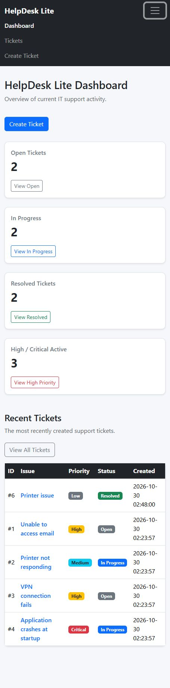
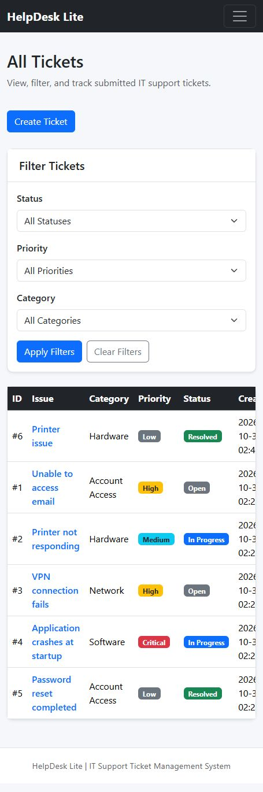
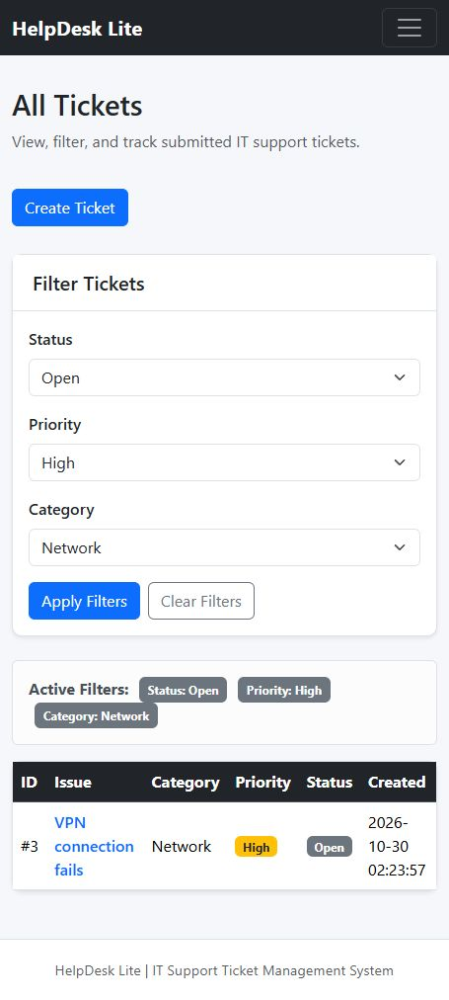
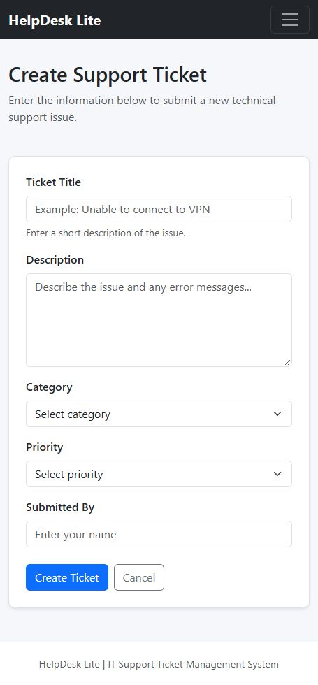
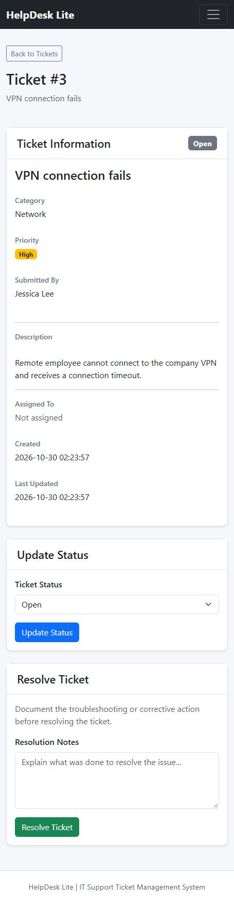
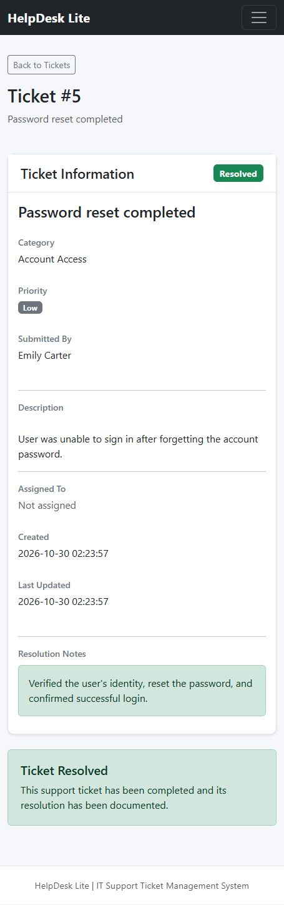

# HelpDesk Lite

HelpDesk Lite is a lightweight IT support ticket management application built with Python, Flask, SQLite, HTML, CSS, Bootstrap, and Jinja.

The project simulates a small internal help desk system where users can create technical support tickets, track issues, update ticket status, filter tickets, and document how problems were resolved.

The project was intentionally kept small enough to understand, test, maintain, and explain from beginning to end.

---

## Project Purpose

The goal of HelpDesk Lite is to demonstrate a complete IT support ticket workflow in a simple web application.

The application demonstrates how to:

- Accept user input through web forms
- Validate submitted information
- Store support tickets in a relational database
- Retrieve and display database records
- Update existing tickets
- Track ticket status
- Filter tickets
- Display support activity on a dashboard
- Document troubleshooting and resolutions
- Handle missing pages and tickets
- Use parameterized SQL queries
- Test important application behavior automatically

---

## Features

### Create Support Tickets

Users can create a support ticket containing:

- Ticket title
- Issue description
- Category
- Priority
- Submitted by

New tickets automatically begin with the status:

```text
Open
```

Available categories include:

```text
Software
Hardware
Network
Account Access
Other
```

Available priorities include:

```text
Low
Medium
High
Critical
```

---

## View All Tickets

The Tickets page displays support tickets in a table.

The table includes:

- Ticket ID
- Issue title
- Category
- Priority
- Status
- Creation date

Clicking a ticket title opens the complete ticket details.

Bootstrap badges are used to make ticket priority and status easier to identify.

---

## Ticket Filtering

Tickets can be filtered by:

- Status
- Priority
- Category

The filters can also be combined.

For example, a user can display only tickets that are:

```text
Status: Open
Priority: High
Category: Network
```

The application displays a message when no tickets match the selected filters.

---

## Ticket Details

Each support ticket has its own detail page.

The page displays:

- Ticket ID
- Ticket title
- Full issue description
- Category
- Priority
- Current status
- Submitted by
- Assigned technician
- Creation date
- Last updated date
- Resolution notes

---

## Ticket Workflow

HelpDesk Lite uses the following support workflow:

```text
Open
  |
  v
In Progress
  |
  v
Resolved
```

A ticket can be changed between Open and In Progress.

Before a ticket can be marked as Resolved, a resolution note must be entered.

Resolved tickets are read-only: status changes and replacement resolution notes are rejected by the server.

The resolution note documents the troubleshooting or corrective action performed.

After the ticket is resolved, its resolution information remains visible on the ticket detail page.

---

## Dashboard

The HelpDesk Lite dashboard provides an overview of current support activity.

It displays counts for:

- Open tickets
- In Progress tickets
- Resolved tickets
- Active High and Critical priority tickets

The dashboard also displays recently created tickets.

Dashboard counts are calculated directly from the SQLite database each time the page loads.

---

## Input Validation

HelpDesk Lite validates information before saving it to the database.

Required ticket information includes:

- Title
- Description
- Category
- Priority
- Submitted by

The application uses both:

- HTML form validation
- Server-side Flask validation

Server-side validation ensures that invalid or incomplete information is rejected even if browser-side validation is bypassed.

The application also validates category, priority, and status values.

---

## Empty States

The application provides helpful messages when there is no information to display.

Examples include:

- No tickets have been created yet
- No tickets match the selected filters

Instead of displaying an empty or confusing page, the application provides a message and an appropriate next action.

---

## Error Handling

HelpDesk Lite includes custom error handling.

### 404 Page

A custom 404 page is displayed when:

- A requested page does not exist
- A requested ticket does not exist

The page provides links back to the dashboard and ticket list.

### 500 Page

A custom 500 page is available for unexpected internal application errors.

---

## Database

HelpDesk Lite uses SQLite for local data storage.

The primary database table is:

```text
tickets
```

The ticket table contains:

```text
id
title
description
category
priority
status
submitted_by
assigned_to
created_at
updated_at
resolution_notes
```

SQLite was selected because it provides relational database functionality without requiring a separate database server.

The local SQLite database file is excluded from GitHub.

---

## SQL Safety

Database operations involving user-supplied information use parameterized SQL queries.

User values are passed separately from SQL statements rather than being inserted directly into query strings.

This helps reduce the risk of SQL injection.

---

## Automated Testing

HelpDesk Lite includes automated tests using pytest.

The test suite uses a temporary SQLite database so testing does not modify the normal development database.

The current tests cover:

- Dashboard loading
- Ticket list loading
- Ticket filtering
- Ticket detail pages
- Missing ticket handling
- Ticket creation
- Required field validation
- Invalid category validation
- Ticket status updates
- Invalid status handling
- Required resolution notes
- Successful ticket resolution

Run the complete test suite with:

```powershell
pytest -v
```

The current automated test suite contains 21 test cases covering the main ticket workflows.

---

## Technologies

The project uses:

```text
Python
Flask
SQLite
HTML
CSS
Bootstrap
Jinja
pytest
Git
GitHub
```

### Python

Used for application logic, validation, and database interaction.

### Flask

Used for:

- Application routes
- GET and POST requests
- Form processing
- Redirects
- Template rendering
- Error handling

### SQLite

Used to store and update support ticket information.

### Jinja

Used to display dynamic application and database information inside HTML templates.

### Bootstrap

Used for:

- Responsive layout
- Navigation
- Forms
- Tables
- Cards
- Buttons
- Alerts
- Badges

### pytest

Used to automatically test important application behavior.

### Git and GitHub

Used for source control and project version history.

---

## Project Structure

```text
helpdesk-ticket-tracker/
|
|-- app.py
|-- database.py
|-- schema.sql
|-- seed.py
|-- requirements.txt
|-- README.md
|-- .gitignore
|
|-- static/
|   |-- styles.css
|
|-- templates/
|   |-- base.html
|   |-- dashboard.html
|   |-- tickets.html
|   |-- ticket_detail.html
|   |-- new_ticket.html
|   |-- 404.html
|   |-- 500.html
|
|-- tests/
    |-- test_app.py
```

The local virtual environment, SQLite database, cache files, and environment files are excluded from the repository.

---

## Running the Project Locally

### 1. Clone the Repository

```powershell
git clone https://github.com/DHadi-5722/helpdesk-ticket-tracker.git
```

Move into the project folder:

```powershell
cd helpdesk-ticket-tracker
```

---

### 2. Create a Python Virtual Environment

On Windows:

```powershell
python -m venv .venv
```

Activate it:

```powershell
.\.venv\Scripts\Activate.ps1
```

After activation, the terminal should show something similar to:

```text
(.venv) PS D:\helpdesk-ticket-tracker>
```

---

### 3. Install Dependencies

```powershell
pip install -r requirements.txt
```

---

### 4. Initialize the Database

Run:

```powershell
python database.py
```

This creates the SQLite database and tickets table. **Running this command again deletes existing tickets and rebuilds the table.**

---

### 5. Add Sample Tickets

Sample support tickets can optionally be added with:

```powershell
python seed.py
```

The seed script provides example IT support issues for testing and demonstration.

---

### 6. Start the Application

Run:

```powershell
python app.py
```

The Flask development server should display an address similar to:

```text
http://127.0.0.1:5000
```

Open the address in a web browser.

---

## Application Pages

### Dashboard

```text
http://127.0.0.1:5000/
```

### All Tickets

```text
http://127.0.0.1:5000/tickets
```

### Create Ticket

```text
http://127.0.0.1:5000/tickets/new
```

### Individual Ticket

Individual ticket URLs use the ticket ID:

```text
http://127.0.0.1:5000/tickets/1
```

---

## Running the Tests

Make sure the virtual environment is active:

```powershell
.\.venv\Scripts\Activate.ps1
```

Then run:

```powershell
pytest -v
```

The tests create and use a temporary database.

The normal local HelpDesk Lite database is not modified by the automated tests.

---

## Sample Support Issues

The included `seed.py` script provides example support issues such as:

- Email access problems
- Printer problems
- VPN connectivity problems
- Application crashes
- Password reset requests

These examples make it easier to test the application without manually creating every ticket.

---

## Git and GitHub

Development was completed using small Git commits so the repository history shows how the application progressed.

Examples of development commits include:

```text
initial HelpDesk Lite project setup

add sample tickets and ticket list navigation

add ticket detail page, custom error handling, UI styling, and test setup

add ticket creation form and validation

add ticket status updates and resolution workflow

add ticket filtering by status priority and category

add dashboard ticket counts and recent ticket overview

improve navigation layout empty states and error pages

add automated tests for core ticket workflows
```

The following local files and folders are excluded using `.gitignore`:

```text
.venv/
__pycache__/
*.pyc
*.db
.env
.pytest_cache/
.vscode/
```

---

## Screenshots

Screenshots captured from the running local application using its responsive narrow-screen layout.

### Dashboard and navigation

Ticket counts, recent activity, and the expanded navigation menu.



### All tickets

Ticket list with status, priority, and category filter controls. On narrow screens, the table scrolls horizontally.



### Combined filters

Open, High priority, and Network filters applied together.



### Create a ticket

Required fields for submitting a new support request.



### Active ticket workflow

Full ticket information, status updates, and the resolution form.



### Resolved ticket

Saved troubleshooting notes and the completed ticket state.




---

## Current Project Status

The current version includes:

- Flask web application
- SQLite database
- Database initialization
- Sample ticket data
- Ticket creation
- Ticket listing
- Ticket detail pages
- Status updates
- Ticket resolution workflow
- Required resolution notes
- Updated timestamps
- Status filtering
- Priority filtering
- Category filtering
- Combined filters
- Dashboard ticket counts
- Recent ticket display
- HTML form validation
- Server-side validation
- Parameterized SQL
- Empty-state messages
- Responsive Bootstrap navigation
- Custom 404 page
- Custom 500 page
- Automated pytest test suite
- Git source control
- Local development setup instructions

---

## Possible Future Improvements

The current version is intentionally limited to a small, complete help desk application.

Possible future improvements could include:

- Assigning tickets to technicians
- Ticket comments or troubleshooting history
- Keyword search
- Reopening resolved tickets
- Pagination
- Sortable ticket columns
- CSV export
- User authentication
- User roles
- PostgreSQL support
- Deployment to a hosted environment
- REST API endpoints

These features are not required for the current version of HelpDesk Lite.

---

## What I Learned

Building HelpDesk Lite provided practice connecting the major parts of a web application.

Important concepts included:

- Creating Flask routes
- Handling GET and POST requests
- Processing HTML forms
- Performing server-side validation
- Working with SQLite from Python
- Writing parameterized SQL statements
- Creating and updating database records
- Rendering data with Jinja templates
- Building ticket filtering
- Tracking ticket status
- Designing a support workflow
- Creating dashboard database queries
- Handling application errors
- Designing empty states
- Building responsive pages with Bootstrap
- Creating automated tests with pytest
- Using temporary databases during testing
- Using Git throughout application development

One of the most important concepts demonstrated by the project is the complete application flow:

```text
User Request
    |
    v
Flask Route
    |
    v
Python Application Logic
    |
    v
SQLite Database
    |
    v
Jinja Template
    |
    v
Browser Response
```

The project also demonstrates the development cycle:

```text
Build
  |
  v
Test
  |
  v
Debug
  |
  v
Document
  |
  v
Improve
```

---

## Project Goal

HelpDesk Lite is designed as a small but complete portfolio application.

The goal is not to recreate a large enterprise help desk platform.

The goal is to demonstrate the ability to:

```text
Build
Debug
Test
Document
Maintain
Explain
```

a useful application from beginning to end.